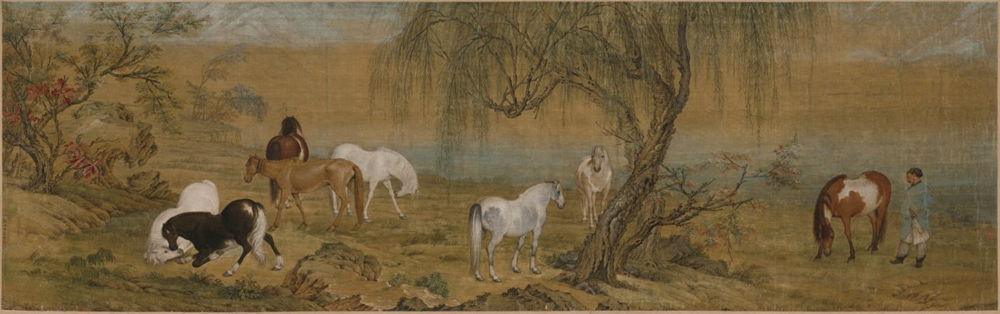
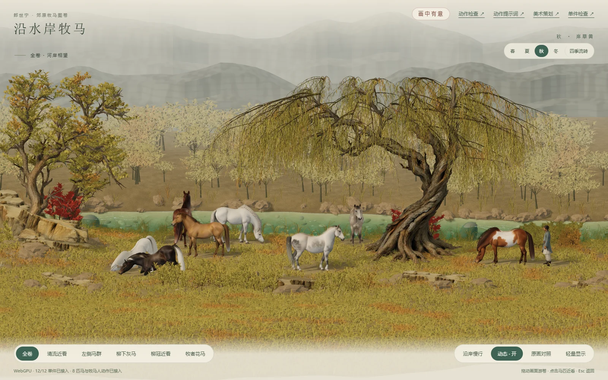
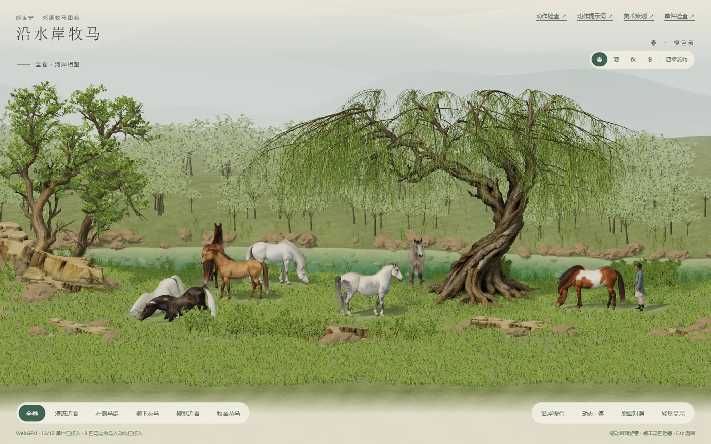
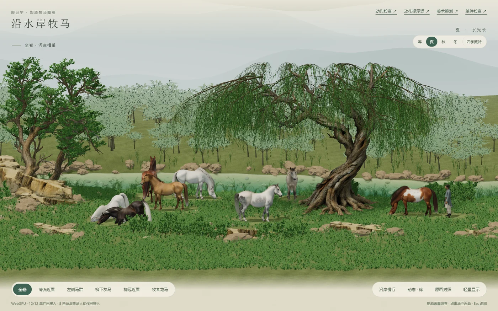
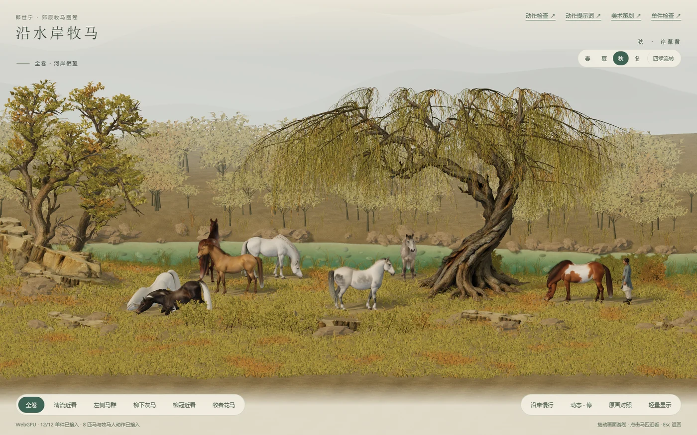
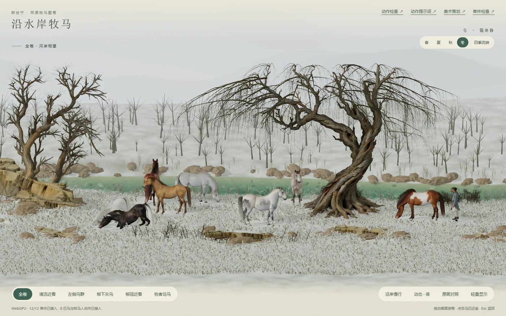
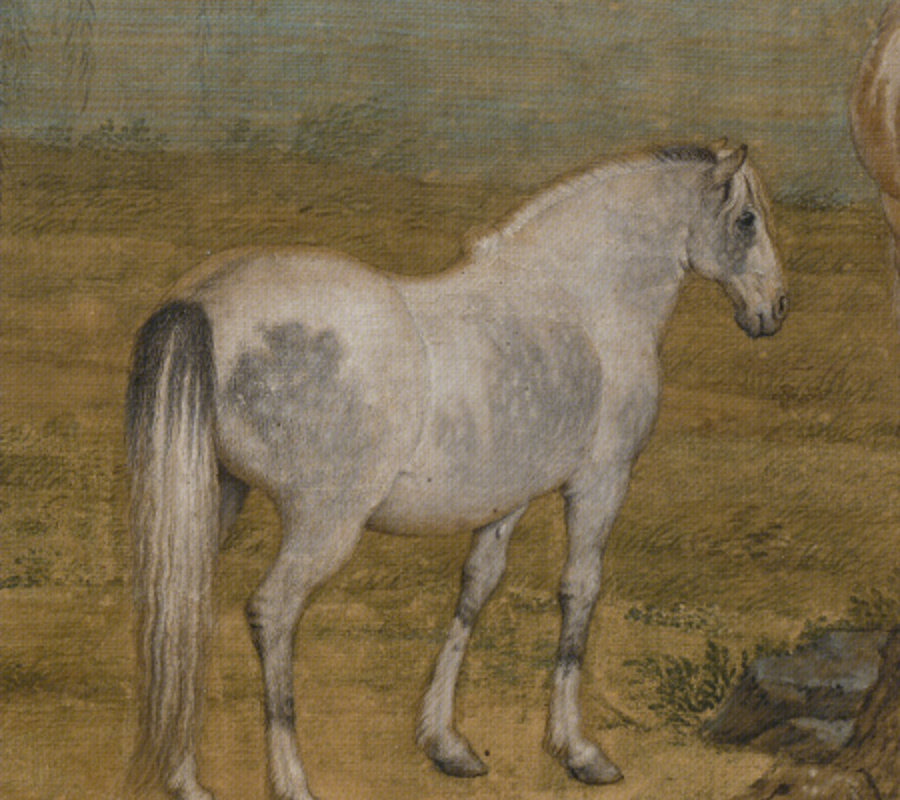
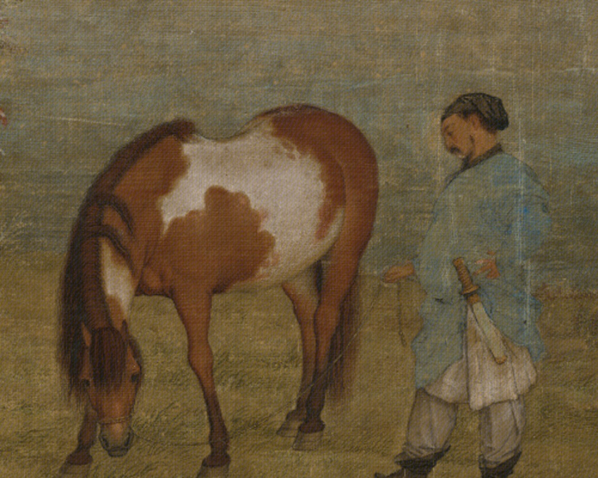
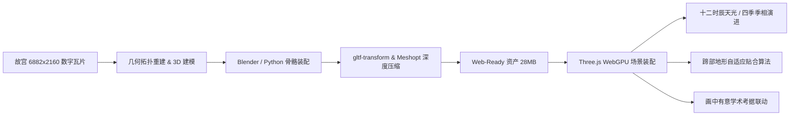

# 沿水岸牧马 · 郊原牧马图 (Riverside Eight Horses)

<p align="center">
  
</p>

<p align="center">
  <strong>郎世宁《郊原牧马图》（八骏图）WebGPU / Three.js 三维数字化交互复原与学术考据系统</strong><br>
  <em>Interactive 3D Digital Heritage Restoration & Academic Study of Giuseppe Castiglione's Eight Horses</em>
</p>

<p align="center">
  <a href="https://github.com"></a>
  <a href="LICENSE"></a>
  <a href="https://threejs.org/"></a>
  <a href="https://vitejs.dev/"></a>
  <a href="#测试与质量验证"></a>
  <a href="#学术考据研究"></a>
</p>

---

## 📖 项目简介 (Project Overview)

清代宫廷画师、意大利传教士**郎世宁（Giuseppe Castiglione，1688—1766）**独立绘制的绢本名作**《郊原牧马图》（又称《八骏图》卷）**，现珍藏于北京故宫博物院。该作是郎世宁雍正年间融合欧洲文艺复兴解剖透视与中国传统设色山水的写实巅峰标准器。

**「沿水岸牧马」v1.0.0** 是一个面向数字文化遗产保护与前沿三维图形技术的全息交互重构系统。本项目以故宫 6882×2160 超高清数字文物扫描件为蓝本，依托 **Three.js WebGPU** 现代图形管线，将二维平展的中国传统长卷完整升维为具有真实物理光照、地貌起伏、植被季相、骨骼步态和生物微动的可交互三维沉浸世界。

<p align="center">
  
  <br>
  <em>三维场景主视角：河岸相望、秋风拂柳与八骏散牧</em>
</p>

---

## ✨ 核心特性 (Key Features)

### 1. 🌐 Next-Gen WebGPU 实时渲染管线
* 基于 Three.js WebGPU / TSL 架构打造，支持高保真物理光照（PBR）、软阴影与双层各向异性水体着色。
* 提供动态降级与轻量显示模式，在不同算力设备上均可流畅交互。

### 2. 🐎 独立骨骼绑定与自主生物微动
* **多角色骨架装配**：针对全画 8 匹骏马（H01～H08）与 1 名牧马人（P01）分别构建 46 骨骼与 36 骨骼独立动捕级骨架。
* **生物步态与微动**：精确还原待机呼吸、耳动、甩尾、低头采食、抬头回正与四拍慢步行进（Four-beat walk）。
* **地形贴合与接触校准**：基于河岸高程场实现生物蹄部与起伏地表的毫米级接触检测。

### 3. 🍂 动态四季演变系统 (Four Seasons Cycle)
* **季节平滑流转**：春草嫩绿、盛夏浓郁、秋日岸草金黄、寒冬落叶覆霜。
* **程序化植被褪色与落叶**：多层掌状叶与垂柳上千片枝叶根据季相着色，并在冬季实现渐进式物理脱落。

<p align="center">
  
  
</p>
<p align="center">
  
  
</p>

### 4. ☀️ 十二时辰自然光照循环 (Twelve Shichen Solar Cycle)
* 完整模拟中国传统**子、丑、寅、卯、辰、巳、午、未、申、酉、戌、亥**十二时辰天光天色。
* 计算太阳赤纬、晨昏蒙影（Twilight）、正午强直射与深夜幽蓝漫射光，子夜时分跨夜自然回环。

### 5. 📜 “画中有意” 深度学术考据与随卷读画
* **内置学术考据导览面板**：点击马匹或角色，即时展示其历史画卷渊源、相马术品级与服饰考辨。
* **文献研究联动**：附带完整的学术考据成果 [《郊原牧马图_考据研究.md》](郊原牧马图_考据研究.md)，对画作无“臣”字款成因、内务府上驷院官制、察哈尔部族服饰、南苑皇家马场等进行翔实文献论证。

### 6. 🔍 原画像素级镜像对照与多镜头导览
* **一键原画对照**：随时叠加 6882×2160 故宫藏本高分辨率扫描原画，对比三维复原空间与原作构图的一致性。
* **6 大电影级机位**：全卷相望、清流近看、左侧马群、柳下灰马、柳冠近看、牧者花马。

---

## 🏛️ 学术考据与历史还原 (Academic Background)

详尽研究报告见：[📖《郎世宁〈郊原牧马图〉（八骏图）学术考据研究》](郊原牧马图_考据研究.md)

### 1. 八骏毛色与相马术考证

| 编号 | 画面位置与姿态 | 传统相马术命名 | 现代马种毛色对应 | 考据学细节与寓意 |
| :---: | :--- | :--- | :--- | :--- |
| **H01** | 最右侧，俯首啃食草皮 | **杂花骢 / 红白花斑马** | Pinto / Piebald（花斑栗色） | 栗色底毛覆大块白斑，清代上驷院称“白章赤骝”。 |
| **H02** | 主柳树右后方，伫立回望 | **浅青骢 / 银骢** | Light Dapple / Grey | 淡青灰微泛柔和浅棕，体态清秀温驯。 |
| **H03** | 主柳树正下方（全卷视觉重心） | **玉花骢 / 菊花青** | Dapple Grey（菊花青） | 灰白底色，臀部分布青灰环状斑纹，杜甫“先帝天马玉花骢”名品。 |
| **H04** | 中景左侧水岸边，低头饮水 | **白义 / 玉顶白骢** | Pure White（纯白马） | 通体洁白如雪，银鬃丰盈，与幽蓝河水形成鲜明映衬。 |
| **H05** | 中景草甸中央，侧身向左站立 | **赤骥 / 铜色赭黄马** | Chestnut / Sorrel | 铜赭皮毛，肋骨隐见，古相马术“瘦骨如霜、风骨内敛”之相。 |
| **H06** | 赭黄马后方，背对昂首远眺 | **骅骝 / 枣红马** | Dark Bay | 深红褐色躯干，鬃尾与四肢下截乌黑，体格魁硕壮健。 |
| **H07** | 左前方近景，仰身倒地翻滚 | **铁青 / 盗骊** | Jet Black / Dark Iron | 全身毛色黑亮如铁，四蹄向上翻腾打滚，极富张力。 |
| **H08** | 左前方近景，侧卧草甸仰首 | **白练 / 玉骢** | Pure White | 雪白皮毛，四肢跪卧，与黑马鼻息相触、嬉戏依偎。 |

<p align="center">
  
  
</p>

### 2. 牧马人身份考据
* **编制归属**：清代**内务府上驷院（满语：Adun ing）**派驻皇家牧场的基层官役——**“苏达喇齐”（sudaraci，专司放牧鞍马之役官/圉长）**。
* **服饰与装备**：天蓝色缺襟行袍、折裥白裤、快靴；腰系白皮鞘清式直鞘腰刀（解手刀）；深目高颧蓄八字髭，展现典型察哈尔蒙古或西北部族马官特征。

### 3. 地理空间考据
* 原型为清代皇家最大的马厂——**北京南苑（南海子）**，结合塞北察哈尔草场与承德热河山水气象提炼而成。

---

## 🛠️ 快速开始 (Quick Start)

### 环境要求
* [Node.js](https://nodejs.org/) >= 18.0.0
* 支持 WebGPU 的现代浏览器（Chrome / Edge 113+ 等；若不支持将自动启用原画对照降级模式）

### 1. 克隆代码库
```bash
git clone https://github.com/your-username/riverside-eight-horses.git
cd riverside-eight-horses
```

### 2. 安装依赖
```bash
npm install
```

### 3. 启动本地开发服务
```bash
npm run dev
```
启动后在浏览器中访问终端输出地址（通常为 `http://127.0.0.1:5173/`）。

### 4. 构建生产产物
```bash
npm run build
npm run preview
```

### 5. 执行自动化测试套件
```bash
npm test
```
*包含 18 项自动化单元与装配测试：骨骼锚点、地形接触、四季光照倍率、时辰跨夜计算、掌状叶几何有效性等。*

---

## 🗂️ 目录结构 (Repository Structure)

```text
├── docs/                       # 项目文档与图片素材
│   └── images/                 # 高清预览截图、机位特写与四季画廊
├── public/                     # 生产运行时静态资源 (体积控制在 ~32MB)
│   ├── models/                 # 压缩优化后的高保真 Web-ready 3D 模型
│   │   ├── h01~h08/            # 8 匹马独立骨骼装配 GLB 及装配报告
│   │   ├── p01/                # 蓝衣牧马人独立骨骼装配 GLB
│   │   └── prepared/           # 12 组经 Meshoptimizer 压缩的场景组件
│   └── references/             # 学术考据文本与原画参考图
├── scripts/                    # 自动化管线工具 (骨架生成、资产烘焙、测试校准)
├── src/                        # 源代码
│   ├── pasture/
│   │   ├── main.js             # 主场景装配与交互中枢
│   │   ├── assets.js           # 3D 资产载入、度量与地形锚定
│   │   ├── seasons.js          # 四季变换、叶片褪色与冬落叶逻辑
│   │   ├── time-of-day.js      # 十二时辰自然光照、太阳仰角与跨夜循环
│   │   ├── culture.js          # “画中有意” 深度学术导览交互
│   │   ├── motion.js           # 采食、待机、观察等程序化动画
│   │   ├── cast-motion.js      # 全角色骨架动作剪辑与混合
│   │   ├── spatial.js          # 地形高程函数与坐标投影
│   │   ├── river.js            # 动态河流水面与着色器
│   │   └── plants.js           # 植被分布与掌状叶生成算法
│   ├── asset-review.js         # 单件资产在线检视逻辑
│   └── motion-review.js        # 骨骼动作在线校准与慢走验证
├── tests/                      # 核心系统与算法自动化测试 (18 项)
├── index.html                  # 主应用入口
├── asset-review.html           # 3D 单件资产独立检视页
├── motion-review.html          # 骨架与动画动作独立检视页
├── download_and_stitch.py      # 故宫数字文物瓦片下载与拼图脚本
├── 郊原牧马图_考据研究.md       # 1.5 万字故宫典藏学术考据研究报告
├── package.json
└── vite.config.js
```

---

## 💡 关键工程与技术突破 (Technical Highlights)



1. **从 1GB 到 28MB 的极致轻量化**：
   原始制作期 12 组无损高模体积超过 920MB。项目采用 `@gltf-transform` 与 `meshoptimizer` 执行无损拓扑重构、纹理 WebP/Basis 转换与顶点量化，将体积压缩超过 **97%**，实现免等待秒开体验。
2. **纯 CPU/GPU 混合地形高程与蹄部贴合**：
   通过数学闭式解析曲面函数与顶点采样，实现不依赖复杂物理引擎的轻量级逐蹄高程动态校准。
3. **真实天体光照模型**：
   十二时辰系统严格遵循天体力学太阳高度角与大气散射衰减规律，彻底杜绝了光照强度倍率在换季与换时辰时的数值漂移。

---

## 📜 许可证 (License)

本项目代码部分基于 [MIT License](LICENSE) 开源。  
画作原本系清代郎世宁绘，原件藏于北京故宫博物院，属公有领域（Public Domain）文化遗产。

---

## 🤝 鸣谢与致敬 (Acknowledgements)

* **北京故宫博物院**：感谢其对中华传统文化瑰宝的高精数字保护与公开成果。
* **郎世宁（Giuseppe Castiglione）**：致敬三百年前沟通东西方美术精粹的先驱巨匠。
* **Three.js 团队**：致敬持续推动 Web 3D 与 WebGPU 普及的开源贡献者。
